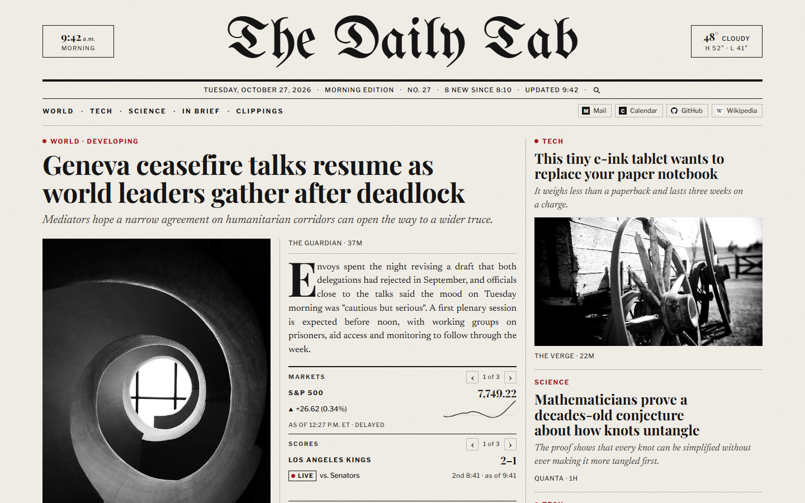

# The Daily Tab

A browser extension that replaces your new-tab page with a news front page laid out like a printed
broadsheet. Headlines come from RSS and Atom feeds you choose, refresh in the background every 15
minutes, and open instantly, even offline. It also has a weather ear and a markets box, both
optional.



<sub>The front page with sample stories, as shown by `npm run preview`.</sub>

It runs on **Microsoft Edge** and **Google Chrome**. It isn't in either browser's store, so you
build it from this repository and load it yourself, which takes about five minutes.

## What you need

- **Node.js 22 or newer.** Download the LTS installer from [nodejs.org](https://nodejs.org/), or on
  Windows run `winget install OpenJS.NodeJS.LTS`. Check it with `node --version`.
- **Git**, to download the code (or use **Code → Download ZIP** on GitHub and unzip it).
- Microsoft Edge or Google Chrome.

## 1. Download and build

Open a terminal (PowerShell on Windows, Terminal on macOS) and run:

```sh
git clone https://github.com/lmcglynn/the-daily-tab.git
cd the-daily-tab
npm install
```

Then build for your browser:

| Browser        | Command                | Output folder        |
| -------------- | ---------------------- | -------------------- |
| Microsoft Edge | `npm run build:edge`   | `.output/edge-mv3`   |
| Google Chrome  | `npm run build:chrome` | `.output/chrome-mv3` |

The output folder is inside the `the-daily-tab` folder. It starts with a dot, so your file browser
may hide it; you can type the path into the folder picker in the next step.

## 2. Load it into your browser

### Microsoft Edge

1. Go to `edge://extensions`.
2. Turn on **Developer mode** (left sidebar, or bottom left on narrow windows).
3. Click **Load unpacked** and choose the `.output/edge-mv3` folder.
4. Open a new tab. If Edge asks whether you meant to change your new-tab page, choose **Keep
   changes**.

Edge may show a "Turn off extensions in developer mode" notice when it starts. Close it (don't
turn them off); it's a reminder, not a problem.

### Google Chrome

1. Go to `chrome://extensions`.
2. Turn on **Developer mode** (top right).
3. Click **Load unpacked** and choose the `.output/chrome-mv3` folder.
4. Open a new tab. If Chrome asks whether to change it back, choose **Keep it**.

Keep the folder where it is: the browser loads the extension from it each time it starts.

## 3. First run

The first new tab asks you to **choose your sections** (National, World, Sports, Investigative,
Culture, Los Angeles, Science and Tech, each fed by one or more newsrooms). Untick any you don't want and
click **Print the first edition**.

Your browser then asks to let The Daily Tab **read those sites**. It needs that to download their
feeds, and it asks for those sites only: nothing about your browsing is read or sent anywhere.
The first edition prints a few seconds later.

## Settings

Open Settings from the link at the foot of the front page, or from the extension's **Details →
Extension options** on the extensions page. There you can:

- add any news site or feed (paste its address; the feed is found for you), rename, reorder and
  regroup feeds and sections, or import and export an OPML file;
- set the paper's name, day or night edition, photo style, accent color and refresh interval;
- mute topics: stories whose headline or summary mentions a word or phrase you choose are left
  off the page;
- add pinned links under the masthead;
- set a city for the weather (°F or °C), choose the tickers in the markets box, and follow teams
  (NFL, NBA, WNBA, MLB, NHL, MLS, Premier League) in the scores box, live while they play.

Settings also notes any feed that still works but has stopped publishing.

If browser sync is on, your feeds and settings follow you to other computers where you've
installed the extension.

## Keyboard shortcuts

On the front page: **j** / **k** move between stories, **o** or **Enter** opens one, **s** saves it
to your Clippings (or removes it), **n** shows a new edition when one is waiting, and **r**
refreshes now. If the address bar has focus on a new tab, click the page first.

## Clippings

Point at a story and click **Save** next to its byline, right-click its headline or photo and choose
**Save to Clippings**, or press **s** to keep it. Saved stories
are listed under **Clippings** at the foot of the page, linked from the section index, and stay
there after the story itself drops off the paper. They're kept on this computer only.

## Updating

```sh
cd the-daily-tab
git pull
npm install
npm run build:edge      # or build:chrome
```

Then click **Reload** on the extension's card in `edge://extensions` or `chrome://extensions`.
Your feeds and settings are kept.

## Uninstalling

Click **Remove** on the extension's card. Your new tab goes back to the browser's own, and the
stories it saved are deleted. You can then delete the `the-daily-tab` folder.

## Troubleshooting

- **The new tab is still the browser's own.** Check the extension is turned on, then open a new
  tab and accept the "keep changes" prompt. Only one extension can replace the new tab; turn off
  any other that does.
- **A feed shows in the Corrections box at the bottom of the page.** That site didn't answer at
  the last refresh. It retries on its own; if it keeps failing, check the feed in Settings, where
  each feed shows its last result.
- **A feed says "Needs permission to be read".** Click **Allow** next to it in Settings.
- **`npm` isn't recognized.** Node.js isn't installed or the terminal was open before you installed
  it; close the terminal and open a new one.

## For developers

`npm run dev:edge` starts a development build that opens Edge and reloads on save, and
`npm run check` runs lint, type checks and tests. [CLAUDE.md](CLAUDE.md) has the architecture,
commands and conventions, and [PLAN.md](PLAN.md) the build history.
